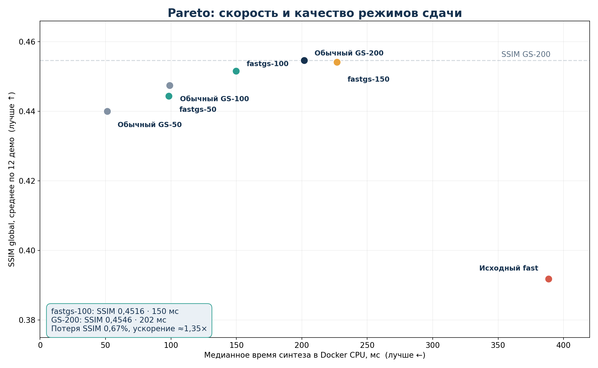

# Фотоника: скорость, режимы сдачи и защита

## 1. Решение по режиму сдачи

**Основной режим для жюри — `--fastgs` со 100 итерациями GS.** Дообученная stage-0 нейросеть создаёт исходную фазу, CPU-инференс переведён в `channels_last`, после чего выполняется 100 итераций многоплоскостного Gerchberg–Saxton. Docker выбирает этот режим автоматически через `DOE_DEFAULT_MODE=fastgs`, поэтому пользовательские четыре PNG запускаются одинаково и с явным флагом, и без него. Режим с 50 итерациями остаётся запасным, если перед защитой выяснится жёсткий лимит времени. `--quality` и `--visual` используются для демонстрации максимального качества отдельно от основного speed-запуска, поскольку занимают секунды и не участвуют в одном честном сравнении на миллисекунды.

Правила подтверждают, что SSIM — основная метрика, Pearson — дополнительная, а время работы модели фиксируется. Испытания проводятся минимум на пяти комплектах по четыре изображения, решение должно запускаться в Docker без ручной установки библиотек. [Тестирование и сдача](TESTING.txt), пункты 2–4. Поэтому выбор делается не по MPS и не по самому красивому восстановлению, а по **SSIM/время в Docker CPU**.



## 2. Проверенная Pareto-таблица

Все метрики ниже получены на одних и тех же 12 демо. Время — медиана синтеза, без генерации `comparison.png`; сохранение DOE и независимая оценка не смешиваются с вычислением фазы. Для fastgs-100 сделано три production-замера: медианы 263,6 / 149,7 / 145,1 мс, в отчёт взята медиана повторов **149,7 мс**, а выброс явно сохранён. Метрики между повторами совпали. [fastgs-100](../results/fastgs/summary-100-run2.json)

| Режим | SSIM global ↑ | Pearson ↑ | Время, мс ↓ | Скорость против GS-200 | Роль |
|---|---:|---:|---:|---:|---|
| Обычный GS-50 | 0,4401 | 0,6691 | 51 | 3,94× | Честный классический fast-reference |
| Обычный GS-100 | 0,4475 | 0,6772 | 99 | 2,04× | Классический reference той же глубины |
| Обычный GS-200 | **0,4546** | **0,6825** | 202 | 1,00× | Качество классического бейзлайна |
| **fastgs-50** | 0,4444 | 0,6707 | **98** | **2,06×** | Запасной режим скорости |
| **fastgs-100** | **0,4516** | **0,6781** | **150** | **1,35×** | **Основной режим сдачи** |
| fastgs-150 | 0,4541 | 0,6815 | 227 | 0,89× | Не выбран: медленнее GS-200 |
| Исходный fast, 6 стадий | 0,3919 | 0,6215 | 389 | 0,52× | Заменён fastgs |
| `--quality` / `--visual` | Выше на соответствующих наборах | Выше на соответствующих наборах | Секунды | Не сопоставляется | Только отдельное quality-демо |

fastgs-100 теряет относительно GS-200 **0,67% SSIM** и **0,65% Pearson**, но сокращает время примерно в **1,35 раза**. Против исходного fast одновременно улучшаются SSIM примерно на **15,2%**, Pearson примерно на **9,1%**, а время уменьшается примерно в **2,6 раза**. fastgs-50 теряет **2,25% SSIM** относительно GS-200, зато работает примерно в **2,06 раза** быстрее. fastgs-150 доказывает, что бесконечно добавлять итерации нельзя: качество почти догоняет GS-200, однако время уже хуже бейзлайна. [GS reference](../results/fastgs/gs-reference.json)

## 3. Что действительно изменилось технически

Во-первых, убраны шесть обучаемых стадий refinement из инференса и использована первая стадия уже существующих дообученных весов. Это не отклонённый student: предыдущие эксперименты со student не прошли пороги и не применяются. Во-вторых, CPU-свёртки переведены в `channels_last`, что снизило нейросетевую часть примерно с 87 до 43 мс. TorchScript оказался медленнее и не используется. В-третьих, нейросетевой старт совмещён с дешёвым многоплоскостным GS, а не сотнями тяжёлых Adam-шагов. Исправлен отдельный баг `gs_batch`, из-за которого старт от массива фазы падал на сравнении со строкой `backprop`; добавлен регрессионный тест.

Наконец, режим по умолчанию перенесён в переменную окружения Docker. Это принципиально: аргументы после имени образа заменяют обычный `CMD`, поэтому одного флага в `CMD` было бы недостаточно. Проверены оба пути: запуск контейнера без аргументов и запуск с `--in-dir /in --out /out` без `--fastgs`. В обоих случаях `metrics.json` содержит `"method": "nn_fastgs"`. Первый холодный запуск со всеми накладными расходами занял **2,17 с**; внутри pipeline синтез занял 192 мс, весь расчёт и запись — 350 мс. Повторный пользовательский запуск показал 144,8 мс на синтез и 272 мс на полный pipeline.

## 4. Почему не заявляем победу над любым классическим методом

Обычный GS-50 остаётся быстрее fastgs-50: **51 мс против 98 мс**, хотя SSIM немного ниже: **0,4401 против 0,4444**. Обычный GS-100 также быстрее fastgs-100: **99 мс против 150 мс**, при SSIM **0,4475 против 0,4516**. Это означает, что нейросетевой старт добавляет качество, но не ускоряет вычисление при строго одинаковом числе итераций. Утверждение для защиты должно быть ограниченным: **«мы улучшили компромисс SSIM/время нашей модели и приблизились к GS-200 по качеству при меньшем времени»**, а не «нейросеть быстрее любой классики».

Также не заявляются достижение физического предела, независимый внешний benchmark и гарантированная обобщаемость на тестах жюри. Все 12 демо используются для сравнительной инженерной оценки. Худший случай `photo_like` показывает SSIM 0,317 и заметные наложения, поэтому его обязательно нужно включить в галерею рядом с сильным `rocket_smoke` (SSIM 0,707) и средним `photo_text` (SSIM 0,427). Такая подача вызывает больше доверия, чем набор только удачных картинок.

## 5. Сценарий защиты на 5 минут

Регламент: 5 минут презентации и 5 минут ответов экспертов; презентация загружается в репозиторий до 13:30. Остановка разработки — 09:30, публикация финалистов — 13:00, защита — 14:00. [Тестирование и сдача](TESTING.txt), пункты 1, 5–6.

### 0:00–0:30 — задача и ограничения

Показать одну схему: четыре grayscale-изображения 128×128 → один phase-only DOE → четыре дистанции. Назвать физические параметры и подчеркнуть, что это не четыре независимые голограммы. На этом слайде не перегружать формулами: достаточно оператора Френеля с одним FFT и кодировки 0 → −π, 255 → +π.

### 0:30–1:15 — архитектура

Показать pipeline: **наследованная stage-0 модель → начальная фаза → channels_last → 100 итераций GS → 8-битный DOE → независимая проверка**. Отдельно сказать, что это гибридный нейросетевой метод, а не попытка выдать GS за нейросеть. Веса и код включены в репозиторий, никаких внешних сервисов при запуске нет.

### 1:15–2:15 — почему такой режим

Очень коротко объяснить три решения: полная шестистадийная модель слишком дорогая в Docker; `channels_last` ускоряет свёртки примерно вдвое; GS-100 даёт лучший компромисс SSIM/время, а 150 итераций уже не выгоден. Не рассказывать все отрицательные эксперименты подряд — оставить их для вопросов. На слайде достаточно Pareto-графика и одной фразы про отклонённый student.

### 2:15–3:00 — числа

Показать только три строки: fastgs-50, fastgs-100 и GS-200. Сформулировать: **«Основной режим теряет 0,67% SSIM относительно GS-200, но работает в 1,35 раза быстрее; относительно нашей исходной модели одновременно растут SSIM и скорость»**. Здесь же обязательно упомянуть обычный GS-50 как более быстрый, но менее точный вариант — вопрос экспертов на эту тему почти неизбежен.

### 3:00–4:00 — Docker-демо

Запустить одну команду на заранее подготовленном комплекте, без ручной установки и скрытых параметров. На экране оставить время, четыре восстановления и `metrics.json`. Демонстрация должна работать офлайн после сборки образа; перед защитой образ собирается и проверяется заранее, а не скачивается заново.

```bash
docker run --rm -e OMP_NUM_THREADS=4 \
  -v "$PWD/in:/in" -v "$PWD/out:/out" doe-synth \
  --in-dir /in --out /out
```

### 4:00–5:00 — визуальная проверка и честные границы

Показать best / median / worst, одинаковую шкалу 0–255 и отсутствие постобработки. Завершить тремя пунктами: выход строго соответствует формату; метрики воспроизводятся независимым оценщиком; остаются спекл и сложные полутоновые случаи, поэтому следующий шаг — новый внешний benchmark. Не заканчивать презентацию обещанием несуществующего ускорения 5× или идеальных изображений.

## 6. Ответы на неудобные вопросы экспертов

**«Почему это нейросетевой метод, если вы запускаете GS?»** Нейросеть является обученным генератором исходной фазы, а GS — фиксированное физическое уточнение без обучаемых параметров. Мы называем метод гибридным и не скрываем это. Код модели и веса включены, вывод полностью локальный.

**«Почему не просто GS-50?»** Он быстрее, но даёт SSIM 0,4401. fastgs-50 даёт 0,4444, fastgs-100 — 0,4516 и остаётся быстрее GS-200. При одинаковом числе итераций нейросеть добавляет качество, а не скорость; это ограничение мы признаём отдельно.

**«Почему не полная сеть и не student?»** Полная сеть в Docker давала 0,3919 SSIM и 389 мс. Student с нуля и усечённые варианты не прошли пороги качества и селективности, поэтому не приняты. Вместо них используется наследованная первая стадия и проверенный GS-refinement.

**«Почему SSIM не 0,55, как на других слайдах?»** Это разные режимы и/или разные наборы. `--visual` может дать более высокие метрики за секунды, но не относится к основному speed-запуску. На одних 12 демо fastgs-100 честно даёт 0,4516.

**«Какой именно SSIM?»** Основной — глобальная формула слайда. Дополнительно сохраняются skimage 7×7 и Gaussian 11×11, поскольку реализация жюри заранее не зафиксирована. Метрики считаются по перечитанному 8-битному DOE, амплитуды нормируются на максимум.

**«Как проверена воспроизводимость?»** Выполнены чистая Docker-сборка, запуск без аргументов и пользовательский запуск без `--fastgs`, 12 демо, независимая проверка PNG и полный набор тестов. `git diff --check` чистый. Скорость измерялась повторно; один выброс не удалён из протокола.

**«Что с обобщением?»** Полностью нового внешнего источника тестов пока нет, поэтому гарантировать поведение на изображениях жюри нельзя. Мы разделяем внутреннюю оценку режимов и внешний benchmark, который должен быть следующим шагом.

## 7. Чек-лист перед Stop Coding

- [x] Исходный код нейросети и обученные веса присутствуют.
- [x] Dockerfile и `requirements.txt` позволяют собрать самодостаточный образ.
- [x] README содержит сборку, запуск и объяснение fastgs.
- [x] Docker без аргументов вызывает fastgs.
- [x] Пользовательские четыре PNG без `--fastgs` также вызывают fastgs.
- [x] `doe.png` имеет PNG L, 8 бит, 128×128, отображение 0 → −π, 255 → +π.
- [x] Восстановления получаются только расчётом Френеля, без ретуши.
- [x] Независимый `evaluate.py` воспроизводит PNG и метрики.
- [x] fastgs-50 и fastgs-100 проверены production-кодом на 12 демо.
- [x] Холодный запуск и повторы скорости задокументированы.
- [x] Обычный GS-50/100/200 оставлены в сравнении, без их скрытия.
- [ ] Перед отправкой выполнить финальный полный тестовый прогон после последнего изменения и проверить ссылку репозитория.
- [ ] До 13:30 добавить презентацию в репозиторий и проверить её на другом компьютере.

Главное правило последнего часа: **не менять режим по новым эстетическим ощущениям**. Меняем только при ошибке формата, падении Docker или подтверждённом превышении Pareto-результата fastgs-100 на тех же данных и в той же среде.
